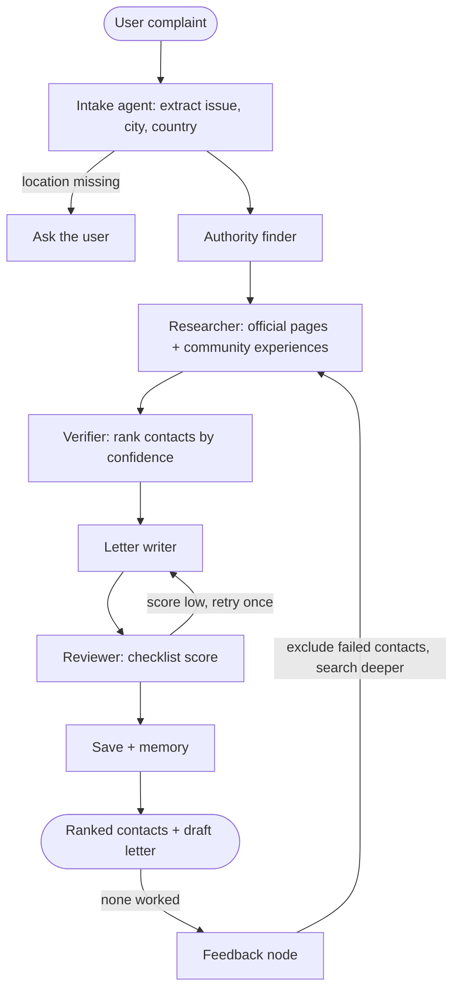

<div align="center">

# 📨 CitizenDesk

### A local, private AI agent that finds the right authority, the contact that actually works, and writes your complaint for you.

*Not a chatbot. A LangGraph multi-agent pipeline that researches, verifies, drafts, and learns from what fails.*

<p>
  
  
  
  
  
  
  
</p>

<p>
  <a href="#-quick-start"><b>Quick start</b></a> ·
  <a href="#-how-it-works"><b>How it works</b></a> ·
  <a href="#-demo"><b>Demo</b></a> ·
  <a href="#-roadmap"><b>Roadmap</b></a> ·
  <a href="https://www.linkedin.com/in/YOUR_LINKEDIN/"></a>
</p>

</div>

---

## 🎯 The problem

You have a real problem: stray dogs in your society, a broken sewer line, a wrong electricity bill. You search online, find five phone numbers, and call them one by one. Most are dead. One answers and says, *"We don't handle this, try another department."*

Generic chatbots make this worse. They produce numbers that **look** right but have no source, and nobody can tell which ones are real.

## 💡 What CitizenDesk does

You describe the problem in plain language, in any country, and the agent:

1. **Understands** the issue, the city, and the country.
2. **Researches** which government body usually handles it there.
3. **Collects contacts** from official pages, with the source URL and date for every phone number and email.
4. **Reads community experiences** (for example Reddit threads) to see which channels people say actually responded, and which sent them elsewhere.
5. **Ranks** the contacts by confidence, and shows *why*.
6. **Drafts** a clear, firm complaint letter or email, with the exact location, duration, impact, and a deadline.
7. **Learns:** if you report that nothing worked, it excludes the failed numbers, follows any "try this office instead" hint, and runs a deeper search.

Everything runs on **your own machine** with a small local model, so your personal details never leave your computer.

## ✨ Features

- 🌍 **Works in any country.** Built around Pakistan, but the research is driven by data profiles, not hard-coded cities.
- 🔒 **Private by design.** Local LLM through Ollama (or llama.cpp). No personal data sent to a model provider.
- 🧾 **No invented numbers.** Phone numbers and emails are extracted by code from fetched pages. The language model never writes a contact.
- 🔍 **Evidence, not guesses.** Every contact and claim carries a source URL and a date.
- 📊 **Confidence labels.** High, Medium, or Low, with the reasons visible.
- 🔁 **Failure-aware.** Records what didn't work and re-researches with a wider search.
- 🧠 **Memory.** SQLite stores past complaints, outcomes, and failed channels.
- 🪶 **Runs on modest hardware.** Designed for an 8 GB RAM, CPU-only machine.

## 🧭 How it works

The agent is a [LangGraph](https://langchain-ai.github.io/langgraph/) state graph. The order of steps is fixed in code, so a small model can't take a wrong turn. The model is only used for narrow jobs: extracting fields, reading search results, and writing the letter.



| Node | Uses the LLM? | Job |
|---|---|---|
| Intake | Yes (JSON) | Extract issue, location, duration, impact, country |
| Authority finder | Yes (small) | Propose which body handles the issue, with sources |
| Researcher | Search + LLM | Fetch pages, extract contacts with code, read experiences |
| Verifier | No | Score and rank contacts |
| Writer | Yes | Draft the letter or email |
| Reviewer | No | Checklist: location, duration, impact, deadline, length |
| Save + memory | No | Write the result to a file and to SQLite |
| Feedback | No | Record failures and redirect hints, trigger deeper search |

### Where the evidence comes from

| Tier | Sources | Used for |
|---|---|---|
| Official | Government and city pages, citizen portals | Which body handles it, listed contacts |
| Community | Reddit, local forums, local news | Which channels worked, failed, or redirected |
| Weak signals | Quora, blogs | Low-weight hints only |

## 🎬 Demo

<!--
ADD YOUR DEMO HERE (pick one):
1. Drag and drop an .mp4 into this file while editing on github.com. GitHub generates a link and shows a player.
2. Put a GIF in docs/ and use: 
3. Clickable YouTube thumbnail:
   [](https://youtu.be/YOUR_VIDEO_ID)
-->

*Demo video coming soon.*

<details>
<summary><b>Example output (illustrative, not real contacts)</b></summary>

```json
{
  "status": "done",
  "issue": "stray dogs in residential society",
  "location": "Example Town, Example City, Example Country",
  "authority": "Municipal animal control (example)",
  "channels": [
    {
      "type": "phone",
      "value": "+00 000 0000000",
      "confidence": "Medium",
      "reasons": ["listed on an official page", "2 community reports say it responded"],
      "source": "https://example.gov/animal-control",
      "found_on": "2026-01-01"
    }
  ],
  "letter": "Subject: Request for action on stray dogs in Example Town ...",
  "review_score": 0.86,
  "saved_file": "outputs/generated_letters/example.md"
}
```

</details>

## 🧰 Tech stack

| Layer | Tools |
|---|---|
| Orchestration | LangGraph |
| LLM runtime | Ollama (default) or llama.cpp |
| Models | Small local models (see below) |
| Web research | Tavily (primary), DuckDuckGo (fallback), trafilatura / Jina Reader for page text |
| Contact extraction | `phonenumbers` plus regex, done in code |
| Memory | SQLite |
| API | FastAPI |
| Language | Python 3.10+ |

## 💻 Requirements

- Python 3.10 or newer
- 8 GB RAM is enough with a small model. No GPU required, though responses will be slower on CPU.
- About 3 to 5 GB of free disk space for one model
- A free [Tavily API key](https://tavily.com) for web search

### Recommended models

Pick the smallest model that handles your language and returns valid JSON. Close heavy apps (browser tabs especially) while running the agent.

| Model | Notes |
|---|---|
| `gemma4:e2b` | Light and a good first try on 8 GB machines |
| `gemma3:4b` | Higher quality, but needs more free RAM |
| `qwen2.5:3b` | Good at structured JSON output |
| `llama3.2:3b` | Solid all-rounder |

> Model files are **not** included in this repository. You download them with Ollama or llama.cpp as shown below.

## 🚀 Quick start

### 1. Clone and install

```bash
git clone https://github.com/YOUR_USERNAME/citizendesk.git
cd citizendesk

python -m venv venv
# Windows
venv\Scripts\activate
# macOS / Linux
source venv/bin/activate

pip install -r requirements.txt
```

### 2. Add your keys

```bash
cp .env.example .env     # Windows: copy .env.example .env
```

Open `.env` and set `TAVILY_API_KEY`. Never commit this file.

### 3. Get a local model (choose Option A or Option B)

#### Option A: Ollama (default)

1. Install Ollama from [ollama.com](https://ollama.com), then check it:

   ```bash
   ollama --version
   ```

2. *(Windows, if your C: drive is low on space)* Store models on another drive **before** pulling. Then fully quit Ollama from the system tray, and open a new terminal:

   ```powershell
   mkdir E:\OllamaModels
   setx OLLAMA_MODELS "E:\OllamaModels"
   ```

3. Start the server and pull a model:

   ```bash
   ollama serve                 # keep this window open
   ollama pull gemma4:e2b       # in a second terminal (or gemma3:4b / qwen2.5:3b)
   ollama list                  # confirm it downloaded
   ```

4. Quick speed check:

   ```bash
   ollama run gemma4:e2b --verbose
   ```

#### Option B: llama.cpp

Use this if you prefer llama.cpp or want to run GGUF models from Hugging Face. llama.cpp provides an **OpenAI-compatible server** that the app talks to.

1. Install llama.cpp (pick one):

   ```bash
   winget install llama.cpp          # Windows
   brew install llama.cpp            # macOS / Linux
   ```

   Or download a pre-built binary from the [releases page](https://github.com/ggml-org/llama.cpp/releases), or build from source:

   ```bash
   git clone https://github.com/ggml-org/llama.cpp.git
   cd llama.cpp
   cmake -B build
   cmake --build build --config Release -j
   ```

2. Start the server. The `-hf` flag downloads a model directly from Hugging Face (format: `<user>/<model>[:quant]`). Start with a small model on 8 GB RAM:

   ```bash
   llama-server -hf ggml-org/gemma-3-1b-it-GGUF --port 8080 -c 2048
   ```

   To use a GGUF file you already downloaded:

   ```bash
   llama-server -m path/to/model.gguf --port 8080 -c 2048
   ```

3. In `.env`, point the app at it:

   ```env
   LLM_BACKEND=llamacpp
   LLAMACPP_BASE_URL=http://localhost:8080/v1
   ```

### 4. Run it

```bash
# API with an interactive docs page
uvicorn app.api:app --reload
# then open http://127.0.0.1:8000/docs

# or the command-line demo
python demo.py
```

## ⚙️ Configuration

| Variable | Default | Description |
|---|---|---|
| `TAVILY_API_KEY` | none | Web search key (required for research) |
| `LLM_BACKEND` | `ollama` | `ollama` or `llamacpp` |
| `MODEL_NAME` | `gemma4:e2b` | Model to use with Ollama |
| `OLLAMA_BASE_URL` | `http://localhost:11434` | Ollama server address |
| `LLAMACPP_BASE_URL` | `http://localhost:8080/v1` | llama.cpp server address |
| `OLLAMA_MODELS` | system default | Where Ollama stores model files |

Speed tuning (in `app/config.py`): `NUM_CTX` (context size, lower uses less RAM), `KEEP_ALIVE` (keeps the model loaded between calls), and the token limits for the JSON and writer models.

## 🔌 API

| Endpoint | Purpose |
|---|---|
| `POST /generate-complaint` | Run the agent: ranked contacts and a draft letter |
| `POST /feedback` | Report what happened (worked, no answer, wrong number, wrong department) |
| `GET /history` | Past complaints and outcomes |
| `GET /health` | API and model server status |

## 🗂️ Project structure

```
citizendesk/
├── app/
│   ├── config.py        settings and limits
│   ├── models.py        JSON model and writer model
│   ├── prompts.py       all prompt templates
│   ├── state.py         shared graph state
│   ├── routers.py       conditional-edge decisions
│   ├── graph.py         builds and compiles the LangGraph
│   ├── memory.py        SQLite memory
│   ├── api.py           FastAPI app
│   ├── nodes/           intake, authority, researcher, verifier, writer, reviewer, feedback, save
│   └── tools/           search, extract, contacts, files
├── data/                regions.json, seed_channels.json
├── outputs/             generated letters and saved results
├── tests/
├── demo.py
├── requirements.txt
└── README.md
```

## 🧪 Design principles

1. **The model never invents a contact.** Contacts come from pages, via code, with a source and date.
2. **Fixed flow, small model.** The graph decides the next step. The model does narrow jobs only.
3. **Show the confidence.** Every recommendation says how sure the agent is and why.
4. **Treat failure as data.** Dead numbers and redirects are stored and used in the next search.
5. **Stay private.** Personal details are processed locally.

## ⚠️ Limitations

- The agent **cannot confirm that a phone number is currently active**. It ranks by evidence, and your feedback improves the ranking over time.
- Community knowledge is thin in many places. Some platforms (such as Facebook groups and X) can't be searched for free, so coverage varies by country.
- A small local model is weaker than a large cloud model, especially for Urdu and other low-resource languages. Check drafts before sending.
- Drafted letters are a starting point, not legal advice.

## 🛠️ Troubleshooting

<details>
<summary><b><code>ollama</code> is not recognized</b></summary>

Close the terminal and open a new one so it picks up the updated PATH. If it still fails, find `ollama.exe` (usually under `%LOCALAPPDATA%\Programs\Ollama`) and add that folder to your PATH.
</details>

<details>
<summary><b>The model downloads to C: even after setting <code>OLLAMA_MODELS</code></b></summary>

The background server started before the variable existed. Quit Ollama from the system tray, open a **new** terminal, confirm `echo $env:OLLAMA_MODELS` shows your path, then run `ollama serve` from that terminal and pull in a second one.
</details>

<details>
<summary><b>Responses are very slow or the PC freezes</b></summary>

The model is probably larger than your free RAM, so Windows is swapping to disk. Close other apps, use a smaller model (`gemma4:e2b`, `llama3.2:1b`), keep `NUM_CTX` at 2048, and check `ollama ps`.
</details>

<details>
<summary><b>Research returns nothing</b></summary>

Check that `TAVILY_API_KEY` is set in `.env`. The app falls back to DuckDuckGo when Tavily fails, but that source is unofficial and may be rate-limited.
</details>

## 🗺️ Roadmap

- [ ] Model layer: Ollama connection, JSON model, writer model
- [ ] LangGraph pipeline with conditional edges and a capped revision loop
- [ ] Web research: search, page extraction, contact extraction with sources
- [ ] Verifier with confidence scoring
- [ ] SQLite memory and failed-channel tracking
- [ ] Feedback loop with extended re-research
- [ ] FastAPI endpoints
- [ ] llama.cpp backend option
- [ ] Region profiles for more countries
- [ ] Urdu and Roman Urdu evaluation
- [ ] Optional web UI

## 🤝 Contributing

Ideas, bug reports, and verified region data are welcome. Open an issue first to discuss a larger change.

## 📄 License

Released under the [MIT License](LICENSE).

## 🙌 Acknowledgements

[Ollama](https://ollama.com), [llama.cpp](https://github.com/ggml-org/llama.cpp), [LangGraph](https://langchain-ai.github.io/langgraph/), [Tavily](https://tavily.com), and [FastAPI](https://fastapi.tiangolo.com). Built as part of the AIRI Team PITB AI Internship.

## 👤 Author

**AR-CODE**

[](https://www.linkedin.com/in/YOUR_LINKEDIN/)
[](https://github.com/YOUR_USERNAME)

<div align="center">

If this project helps you, consider giving it a ⭐

</div>